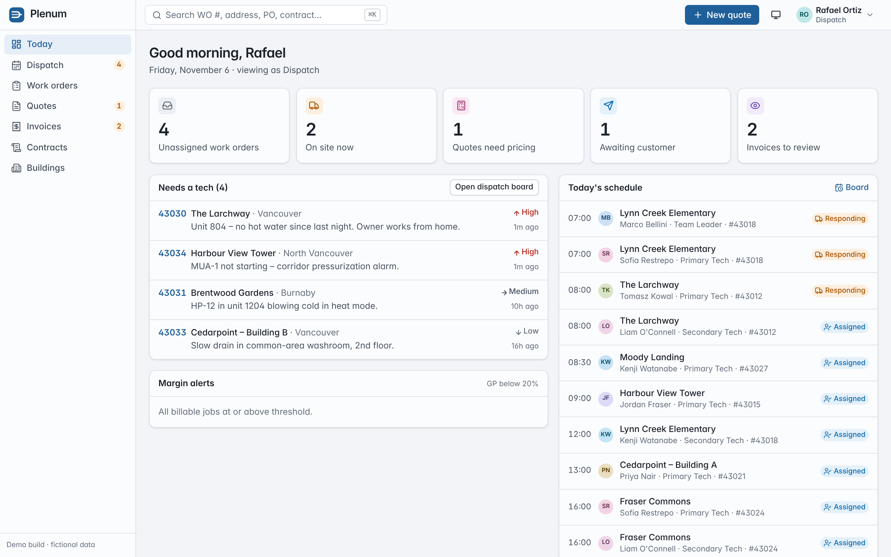
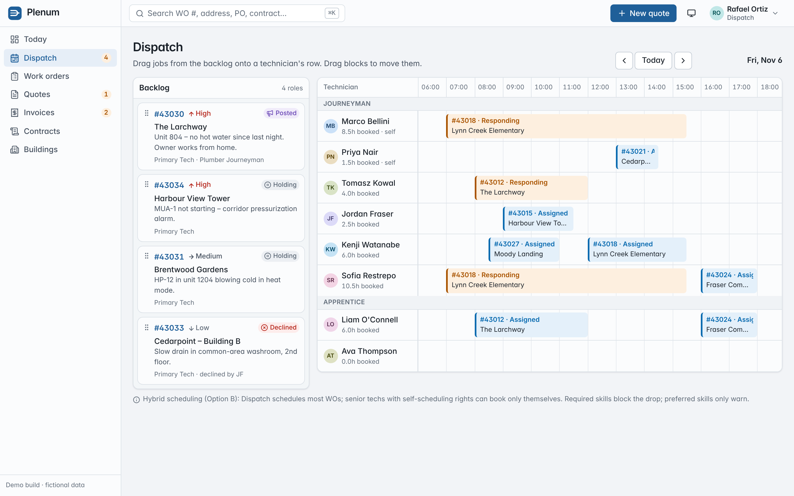
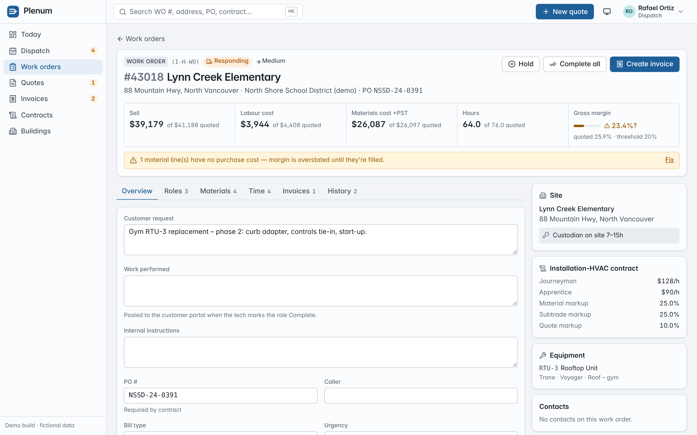
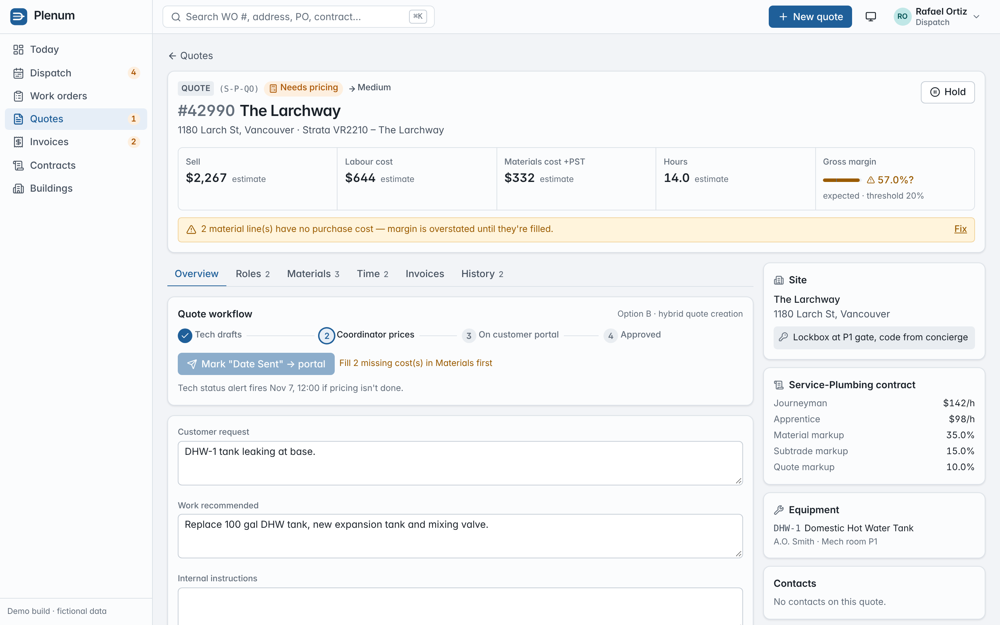
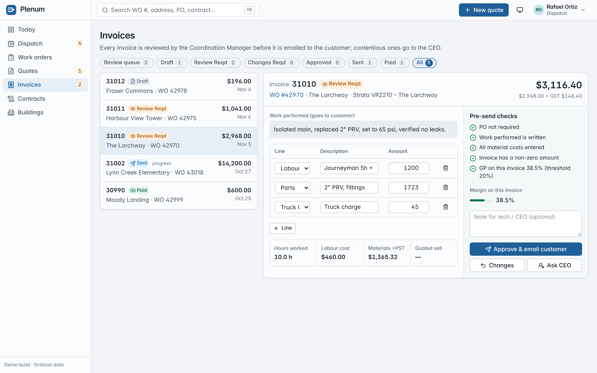
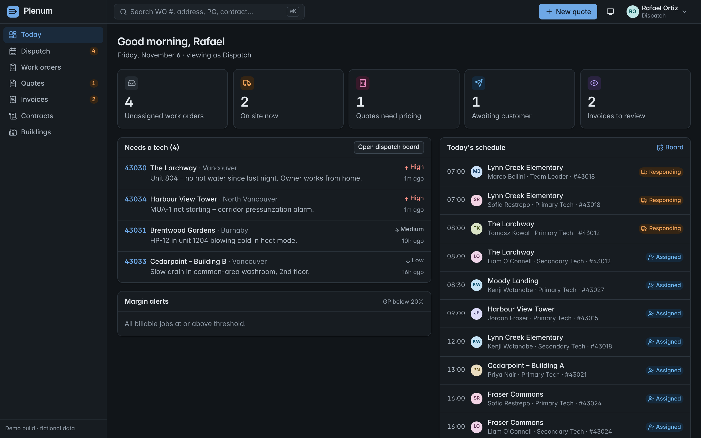

<div align="center">

# Plenum

**Field-service management for HVAC and plumbing contractors.**
Dispatch, quotes, work orders, invoicing and a customer portal in one app.

[](https://plenum-fsm.netlify.app/)


**[plenum-fsm.netlify.app →](https://plenum-fsm.netlify.app/)**



</div>

> All data in the live app and screenshots is fictional.

---

## Overview

Mechanical contractors run on a chain of hand-offs: a request comes in, someone prices it, dispatch books a tech, the tech logs time and materials, and the office turns it into an invoice. When those steps live in spreadsheets and email, jobs get lost and margin leaks.

Plenum puts the whole chain in one place and gives each role its own view. It was designed from the workflow of a working BC mechanical contractor, with a hybrid dispatch model: dispatch books most work, while senior techs can book themselves.

## Highlights

- **Role-based workspaces.** Dispatch, Service Coordinator, Senior Tech and Coordination Manager each get their own Today queue, KPIs and alerts.
- **Drag-and-drop dispatch.** Resource timeline with day and week views. Required skills block a booking, overlaps are flagged, time off and stat holidays block scheduling.
- **Margin protection.** Every work order shows estimate vs. actual and GP%. Quotes can't be sent while any cost is missing; low-margin jobs raise alerts.
- **Quote → work order → invoice.** Tech drafts, coordinator prices, customer approves in the portal, one click converts to a work order. Invoices go through automatic pre-send checks.
- **Progress billing.** Contract value, billed to date, holdback (10% default per the BC Builders Lien Act) and final invoices that release holdback.
- **Customer portal.** Customers approve quotes, see service reports and invoices, and submit service requests. Costs and internal notes never leave the server.
- **Mobile tech view.** One-tap status, notes, time entry, materials and on-device-resized photos.
- **Data migration.** CSV import with auto-mapped columns, reference resolution and a preview of skipped rows.

## Screenshots

<table>
  <tr>
    <td><br/><sub><b>Dispatch</b> — drag jobs from the backlog onto a technician's row</sub></td>
    <td><br/><sub><b>Work order</b> — estimate vs. actual economics and GP%</sub></td>
  </tr>
  <tr>
    <td><br/><sub><b>Quote</b> — tech draft to coordinator pricing to customer approval</sub></td>
    <td><br/><sub><b>Invoice review</b> — automatic pre-send checks</sub></td>
  </tr>
  <tr>
    <td colspan="2"><br/><sub><b>Dark mode</b></sub></td>
  </tr>
</table>

## Feature map

| Area | What it does |
|---|---|
| **Today** | Role-specific queue, KPI tiles, margin alerts, company notices, today's schedule |
| **Dispatch** | Day/week resource timeline, backlog, skill rules, conflict detection |
| **Work orders** | Filter chips, derived status, GP% meter; tabs for roles, materials, time, invoices, history |
| **Quotes** | Draft → price → send → approve → convert to WO |
| **Invoices** | Review queue, approve and send, request changes, credit notes |
| **Contracts / Buildings** | Rates, markups, default roles; sites, access notes, equipment |
| **Equipment** | Register with serials, refrigerant charge, filters and belts; service history; duplicate-serial check |
| **Maintenance** | Recurring PM profiles that generate the month's work orders into the backlog |
| **Price book** | Material costs by SKU/vendor, auto-fill on match, stale prices flagged |
| **Reports** | Revenue, GP%, request-to-scheduled time, quote win rate, tech load, jobs below margin |
| **Organizations / People** | Parent/child hierarchy with roll-up, contact cards |
| **Documents** | Printable PDF quotes, field reports and invoices |
| **Settings** | Taxes, GP% threshold, labour cost, user admin, activity log |

Full list with exact counts: [docs/feature-catalog.md](docs/feature-catalog.md).

## Architecture

```
Next.js 15 (App Router, static export) ──► Netlify
        │
        ├─ Zustand store (persisted) ── local demo mode
        └─ NEXT_PUBLIC_API_URL set ──► plenum-api (REST)
                                       ├─ auth and roles
                                       ├─ optimistic updates with rollback
                                       └─ server-side filtering for the customer portal
```

Without `NEXT_PUBLIC_API_URL` the app runs entirely in the browser with fictional data (reset from the user menu). With it, the app requires sign-in, loads from the API, pushes every change back and rolls back if the server rejects it.

## Getting started

```bash
npm install
npm run dev     # http://localhost:3000 (local demo mode)
npm run build
```

## Design notes

- [docs/design-research.md](docs/design-research.md) — naming, colour and density decisions with sources
- [docs/spec-notes.md](docs/spec-notes.md) — workflow observations and open questions

## Roadmap

Accounting sync (QuickBooks / Sage) is the next integration; it is not built yet.

---

<div align="center">

Designed and built by [@Martikk](https://github.com/Martikk) · Live at **[plenum-fsm.netlify.app](https://plenum-fsm.netlify.app/)**

</div>
